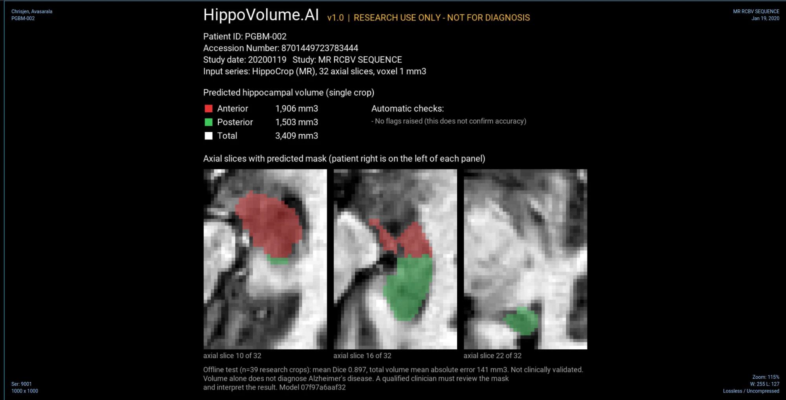
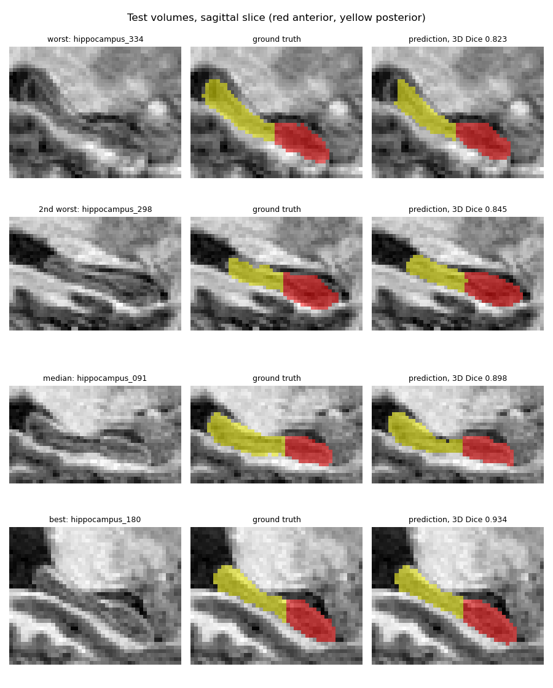
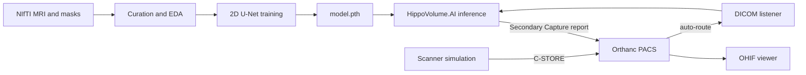
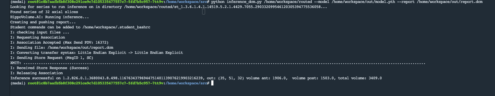
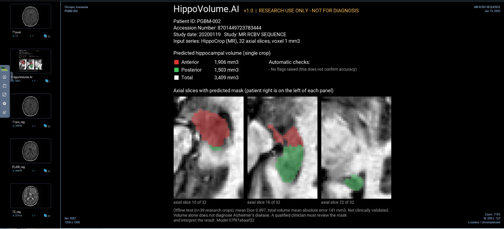
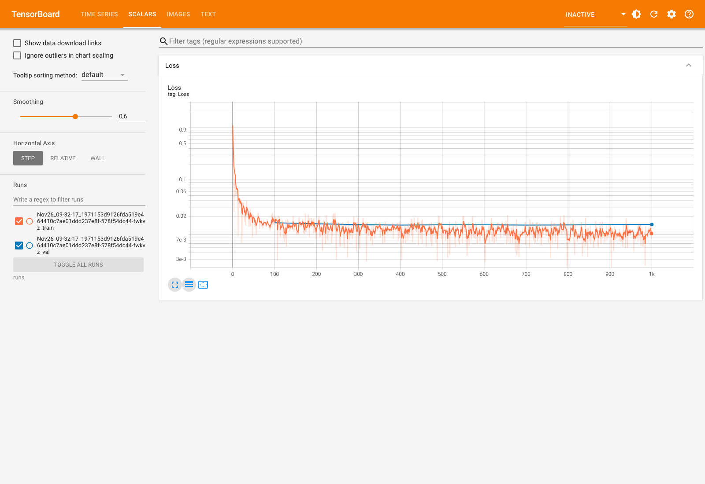

# Hippocampus Volume Quantification from 3D Brain MRI

An end-to-end research prototype: curate brain MRI, train a segmentation network, and return anterior, posterior and total hippocampal volume to a simulated hospital imaging network as a DICOM report.

> **Research and education only.** Not clinically validated, not a medical device, and not a diagnosis of Alzheimer's disease or any other condition.



## Results

Test set: 39 held-out volumes. Trained on a Tesla T4 (PyTorch 1.5.0), 10 epochs in 11 minutes.

| Metric | Whole | Anterior | Posterior |
|---|---|---|---|
| Dice | **0.897** | 0.875 | 0.861 |
| Jaccard | 0.813 | 0.779 | 0.758 |
| Volume mean absolute error (mm³) | 141 | 127 | 120 |
| Volume bias, predicted − manual (mm³) | −113 | −51 | −63 |

Dice ranges from 0.823 to 0.934. The model tends to **underestimate** volume (28 of 39 cases). These are internal test figures from one data source, one split and one submitted training run.



## Pipeline



1. **Data curation.** 263 images and 262 masks inspected; 3 unusable cases removed, 260 pairs kept. Volumes are computed from voxel counts and the image affine.
2. **Segmentation.** Recursive 2D U-Net (31 M parameters) on sagittal slices padded to 64×64; cross-entropy, Adam; split by whole volume, 182 / 39 / 39.
3. **Clinical integration.** The HippoCrop series is selected and checked, segmented, measured, and sent back with C-STORE as a Secondary Capture image.

## Repository layout

| Path | Content |
|---|---|
| `notebooks/` | Data curation and exploratory analysis |
| `src/` | Training pipeline, model, metrics, DICOM inference |
| `deploy/` | Orthanc routing rule and DICOM scripts |
| `tests/` | Unit tests |
| `results/` | Metrics, training log, curation records |
| `models/` | Model card; weights are downloaded separately |
| `docs/` | Technical report, validation plan, clinician note, error analysis |
| `assets/`, `examples/` | Figures, screenshots, sample DICOM report |

## Quick start

```bash
python -m venv .venv && source .venv/bin/activate
pip install -r requirements.txt
```

Get the data from the [course starter repository](https://github.com/udacity/nd320-c3-3d-imaging-starter) (`data/TrainingSet`, `data/TestVolumes`) and place both folders in `data/`.

Curate the dataset (writes `data/curated/`):

```bash
cd notebooks && jupyter nbconvert --to notebook --execute --inplace 01_data_curation_eda.ipynb && cd ..
```

Train and evaluate (writes `outputs/experiments/`; needs 2 GB free disk; a GPU is recommended):

```bash
cd src && python run_ml_pipeline.py
```

```bash
tensorboard --logdir src/runs
```

Run tests (from the repository root):

```bash
python -m pytest -q tests
```

Create a report from a routed study folder without a PACS (`ROUTED` holds one sub-folder per study; weights in `models/`):

```bash
python src/inference_dcm.py ROUTED --no-send --keep-study
```

## PACS deployment

With Orthanc listening on 4242 / 8042, DCMTK installed and OHIF connected to Orthanc:

1. In `deploy/`, run `bash start_listener.sh`.
2. In another terminal, send a study: `storescu 127.0.0.1 4242 -v -aec HIPPOAI +r +sd data/TestVolumes/Study1`
3. Run `python src/inference_dcm.py outputs/routed`.

This flow was demonstrated in a course workspace using the same inference code with workspace paths. After a successful send the routed study folder is deleted.

| Study routed and report stored | Study in the viewer |
|---|---|
|  |  |

## Training monitoring



## Limitations

* One scanner and site; healthy adults and adults with psychotic disorders; no dementia or mild cognitive impairment cohort.
* Right hippocampus only, according to the course description.
* Files carry no subject IDs, so overlap of subjects between splits cannot be ruled out.
* No uncertainty estimate, external test set, repeatability study or reader study.
* The simulated network has no authentication, encryption or error recovery, and its sample studies pair a crop with full-head images from a different study.

See the [validation plan](docs/validation_plan.md), [technical report](docs/technical_report.md) and [error analysis](docs/training_and_error_analysis.md).

## Acknowledgements

Built as a capstone for Udacity's 3D medical imaging course, starting from its code skeleton. U-Net implementation by DKFZ; data from the Medical Segmentation Decathlon. Full attributions in [NOTICE.md](NOTICE.md).
