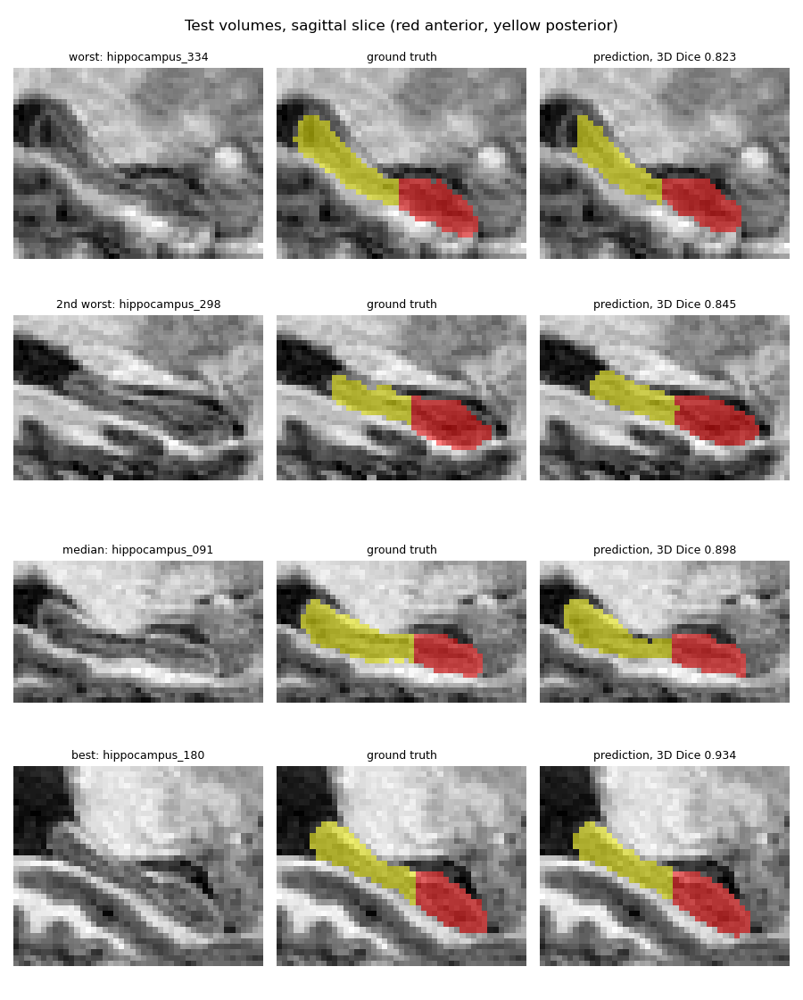

**Subject:** HippoVolume.AI: what it measures and when not to trust it

Dear colleague,

You will be seeing a new image series, "HippoVolume.AI", in studies that include a hippocampus crop. It is a **research tool**. It does not diagnose Alzheimer's disease or show progression.

**What it does.** It outlines the front (anterior) and back (posterior) parts of one hippocampus on a 1 mm T1 crop and reports each volume and the total in mm³, with three axial images showing the outline.

**How well it agreed with manual tracing** on 39 research scans it had not trained on:

* Spatial overlap (Dice; 1.0 is perfect): average 0.90, worst 0.82.
* Total volume: average difference 141 mm³ (4%), largest 450 mm³.
* It tends to read **low**, by 113 mm³ on average, more so in larger hippocampi. About 95% of differences are expected between −400 and +170 mm³.
* The posterior part overlaps manual tracing slightly less well than the anterior.

**Please check every time:** the right patient and side; that the outline follows the hippocampus; no stray patches; the head and tail are not cut off. If the outline is wrong, ignore the number.

**Where it is untested.** All training and test scans came from one scanner at one centre, from healthy adults and adults with psychotic disorders. It has not been tested in dementia, severe atrophy, tumour, surgery, stroke, motion-degraded scans, other scanners or the left side. Differences between two visits smaller than the error above cannot be interpreted.

**Normal ranges.** Do not compare these numbers with published percentile charts; those use different methods.

Automatic warnings on the report catch only obvious failures. "No flags raised" does not mean the result is correct. Your reading stands. Please send us any case where the outline looks wrong.
